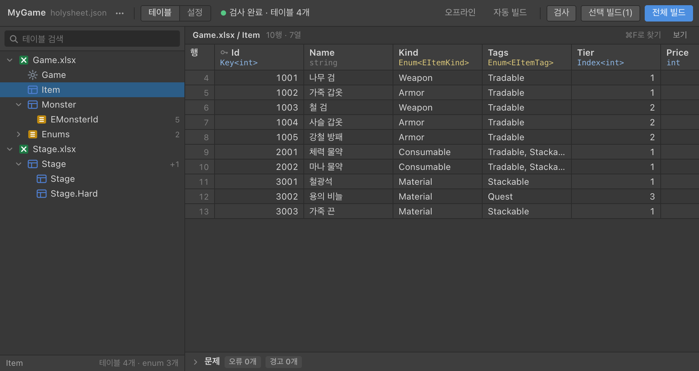

HolySheet는 Excel, CSV, Google Sheets에 작성한 게임 데이터를 C#에서 바로 읽을 수 있는 테이블로 만들어 주는 도구입니다. 시트를 빌드하면 C# 코드와 데이터 파일이 생기고, Unity 클라이언트와 .NET 서버가 같은 파일을 불러옵니다.



## 동작 방식

<div class="hs-flow not-content">
  <div><strong>1. 시트 작성</strong><span>Excel, CSV, Google Sheets에 타입과 이름을 적고 데이터를 채웁니다.</span></div>
  <div class="hs-accent"><strong>2. 검사와 빌드</strong><span>HolySheet가 시트를 읽어 잘못된 셀을 찾고, 문제가 없으면 결과를 씁니다.</span></div>
  <div><strong>3. 생성된 파일</strong><span>테이블마다 C# 클래스(<code>.g.cs</code>)와 데이터 파일(<code>.bytes</code>)이 하나씩 생깁니다.</span></div>
  <div><strong>4. 게임에서 사용</strong><span>코드 한 줄로 불러와 키로 조회합니다.</span></div>
</div>

아이템 시트를 빌드하면 게임 코드에서는 이렇게 씁니다.

```csharp
var source = new StreamingAssetsTableSource("Tables");
GameTables tables = GameTables.Load(source);

ItemRow sword = tables.Item.Get(1001);      // 번호로 한 행 찾기
var tierOne   = tables.Item.ListByTier(1);  // 등급이 1인 아이템 모두
Debug.Log($"{sword.Name} · {sword.Price}골드");
```

`Name`, `Price` 같은 필드는 시트의 열에서 만들어집니다. 필드 이름을 잘못 쓰면 실행하기 전에 컴파일 오류로 알 수 있습니다.

## 주요 기능

| 기능 | 설명 |
| --- | --- |
| 여러 종류의 시트 | Excel 워크북, CSV 폴더, Google Sheets, Google Drive 폴더를 한 프로젝트에서 함께 씁니다. |
| 빌드 전 검사 | 타입에 맞지 않는 값, 중복된 키, 없는 행을 가리키는 참조를 셀 위치와 고치는 방법까지 알려 줍니다. 오류가 하나라도 있으면 코드와 데이터를 쓰지 않습니다. |
| 읽기 전용 테이블 | 불러온 테이블은 게임 코드에서 바꿀 수 없습니다. 값을 바꾸는 코드는 컴파일되지 않습니다. |
| 변조 감지 | 데이터 파일을 불러올 때마다 해시를 확인합니다. 서명을 켜면 파일을 통째로 바꿔치기한 경우도 막습니다. |
| 실행 중 반영 | 게임이나 서버를 끄지 않고 시트 수정 내용을 다시 불러옵니다. |
| 클라이언트와 서버 공용 | 생성된 코드와 데이터는 Unity와 일반 .NET에서 똑같이 동작합니다. |

## 세 가지 도구

세 도구는 같은 설정 파일(`holysheet.json`)을 읽고 같은 결과를 만듭니다. 상황에 맞는 것을 고르면 됩니다.

| 도구 | 이런 때 씁니다 |
| --- | --- |
| [Unity 에디터 창](./tools/window/) | Unity에서 작업하면서 시트를 확인하고 빌드합니다. |
| [데스크톱 앱](./tools/desktop/) | Unity를 설치하지 않은 기획자가 시트를 검사하고 빌드합니다. macOS와 Windows에서 동작합니다. |
| [명령줄 도구](./tools/cli/) | CI에서 자동으로 빌드하거나, 터미널에서 작업합니다. |

## 지원 환경

| 항목 | 지원 범위 |
| --- | --- |
| Unity | 6000.0 이상 (Mono, IL2CPP) |
| .NET | netstandard2.1, .NET 8 이상 |
| 직렬화 라이브러리 | [MemoryPack](https://github.com/Cysharp/MemoryPack)(기본값) 또는 [MessagePack](https://github.com/MessagePack-CSharp/MessagePack-CSharp) |

:::note
버전 2는 처음부터 다시 만든 버전입니다. 1.x(UniGoogleSheets)의 시트 형식, 코드, 데이터 파일과 호환되지 않습니다.
:::

## 어디부터 읽을까요

- **처음 써 본다면** [설치하기](./start/install/)와 [첫 테이블 만들기](./start/first-table/)를 차례로 따라 하세요.
- **시트를 작성한다면** [시트 기본 구조](./sheets/basics/)부터 [시트 나누기](./sheets/splitting/)까지 읽으세요.
- **게임 코드를 작성한다면** [테이블 불러오기](./runtime/loading/)와 [데이터 조회하기](./runtime/reading/)를 읽으세요.
- **빌드를 자동화한다면** [명령줄 도구](./tools/cli/)를 읽으세요.
- **문제가 생겼다면** [자주 겪는 문제](./reference/troubleshooting/)에서 증상을 찾아보세요.
