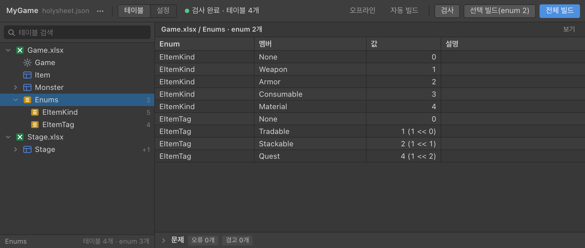

enum은 정해진 선택지 목록입니다. 아이템 종류를 `Weapon`, `Armor`처럼 이름으로 적게 하면, 오타는 검사에서 걸러지고 코드에서는 `EItemKind.Weapon`으로 비교할 수 있습니다.

## Enums 시트 만들기

탭 이름을 **Enums**로 하고, **열 하나에 enum 하나**를 적습니다. 헤더 세 줄은 테이블 시트와 같습니다.

<div class="hs-sheet not-content">
<table>
<thead><tr><th></th><th>A</th><th>B</th><th>C</th><th class="hs-note"></th></tr></thead>
<tbody>
<tr class="hs-head"><th>1</th><td>byte</td><td>Flags&lt;int&gt;</td><td></td><td class="hs-note">저장 타입. 비우면 int</td></tr>
<tr class="hs-head"><th>2</th><td>EItemKind</td><td>EItemTag</td><td></td><td class="hs-note">enum 이름</td></tr>
<tr class="hs-head"><th>3</th><td>아이템 종류</td><td>아이템 속성</td><td></td><td class="hs-note">설명</td></tr>
<tr><th>4</th><td>None</td><td>None</td><td>0</td><td class="hs-note">멤버 이름. C열은 B열의 값</td></tr>
<tr><th>5</th><td>Weapon</td><td>Tradable</td><td>1 &lt;&lt; 0</td><td class="hs-note"></td></tr>
<tr><th>6</th><td>Armor</td><td>Stackable</td><td>1 &lt;&lt; 1</td><td class="hs-note"></td></tr>
<tr><th>7</th><td>Consumable</td><td>Quest</td><td>1 &lt;&lt; 2</td><td class="hs-note"></td></tr>
</tbody>
</table>
<div class="hs-tabs"><span class="hs-on">Enums</span></div>
</div>

- enum 이름 아래로 멤버 이름을 한 줄에 하나씩 적습니다.
- 값을 적지 않으면 위에서부터 `0`, `1`, `2`… 순서로 매겨집니다. 위 예에서 `Weapon`은 `1`, `Armor`는 `2`입니다.
- 워크북마다 Enums 시트를 둘 수 있습니다. 한 워크북에 여러 장이 필요하면 `Battle.Enums`처럼 앞에 이름을 붙입니다.

### 값 직접 정하기

enum 열 **바로 오른쪽 열의 이름 칸을 비워 두면** 그 열은 값을 적는 칸이 됩니다. 위 그림의 C열이 `EItemTag`의 값입니다.

| 값 칸에 적는 형식 | 예 |
| --- | --- |
| 숫자 | `5` |
| 16진수 | `0x10` |
| 비트 이동 | `1 << 3` |
| 다른 멤버의 조합 | `Tradable \| Stackable` |

값을 비운 멤버는 바로 위 멤버의 값에 1을 더합니다.

### 여러 개를 고르는 enum

‘거래 가능’이면서 ‘겹치기 가능’처럼 여러 개를 동시에 고르려면 타입 칸에 `Flags<int>`를 적고, 값을 `1 << 0`, `1 << 1`, `1 << 2`처럼 서로 겹치지 않는 비트로 줍니다. C#의 `[Flags]` enum이 됩니다.

## 열의 타입으로 쓰기

테이블 시트의 타입 칸에 `Enum<EItemKind>`라고 적고, 셀에는 멤버 이름을 적습니다. `Enum<>` 없이 `EItemKind`만 적어도 됩니다.

| `Key<int>` | `string` | `Enum<EItemKind>` | `Enum<EItemTag>` |
| --- | --- | --- | --- |
| Id | Name | Kind | Tags |
| 아이템 번호 | 이름 | 종류 | 속성 |
| 1001 | 나무 검 | Weapon | Tradable |
| 2001 | 체력 물약 | Consumable | Tradable, Stackable |

- 여러 개를 고르는 enum은 `Tradable, Stackable` 또는 `Tradable|Stackable`로 적습니다.
- 빈 셀은 값이 `0`인 멤버가 됩니다. 그래서 첫 멤버를 `None`으로 두는 것이 좋습니다.
- Enums 시트에 없는 이름을 적으면 검사에서 오류가 납니다.

```csharp
ItemRow potion = tables.Item.Get(2001);

if (potion.Kind == EItemKind.Consumable) { /* … */ }
if (potion.Tags.HasFlag(EItemTag.Stackable)) { /* … */ }
```

HolySheet 창의 목록에서 **Enums**를 누르면 정의한 enum과 실제로 매겨진 값을 확인할 수 있습니다.



## 행에 이름 붙이기

코드에서 `tables.Monster.Get(2)`라고 쓰면 2번이 어떤 몬스터인지 알기 어렵습니다. `Mapping<EMonsterId>` 열을 두면, 그 열에 적은 이름이 enum 멤버가 되고 그 행의 키가 멤버의 값이 됩니다.

| `Key<int>` | `Mapping<EMonsterId>` | `string` | `int` |
| --- | --- | --- | --- |
| Id | Code | Name | Hp |
| 몬스터 번호 | 코드에서 쓸 이름 | 이름 | 체력 |
| 1 | Slime | 슬라임 | 30 |
| 2 | Goblin | 고블린 | 80 |

이 시트에서 `enum EMonsterId { Slime = 1, Goblin = 2 }`가 만들어집니다.

```csharp
MonsterRow goblin = tables.Monster.Get((int)EMonsterId.Goblin);
```

- 매핑 열을 쓰려면 테이블에 정수 키가 있어야 합니다.
- 이름이 필요 없는 행은 칸을 비워 둡니다. 같은 이름을 두 번 쓸 수는 없습니다.
- 매핑 열 자체는 데이터로 저장되지 않습니다. `MonsterRow`에 `Code` 필드는 생기지 않습니다.
