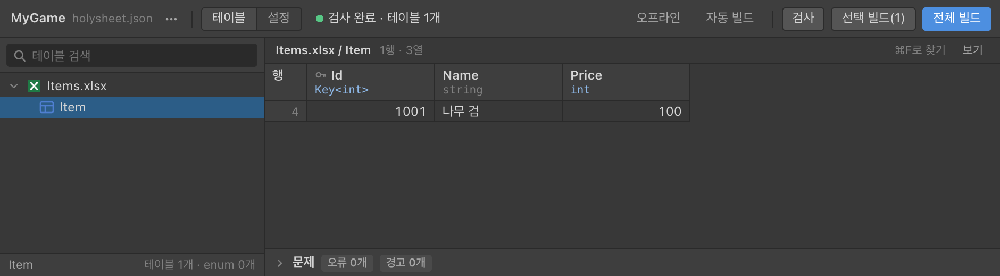

Excel에 ‘나무 검’ 한 줄을 입력하고, Unity 콘솔에서 아이템 번호로 이름과 가격을 조회합니다. [설치하기](../install/)를 마친 프로젝트에서 시작합니다.

## 1. 아이템 입력하기

Excel에서 새 통합 문서를 만들고 시트 탭 이름을 **Item**으로 바꿉니다. A1부터 아래처럼 입력하고 프로젝트의 `Sheets` 폴더에 `Items.xlsx`로 저장합니다.

<div class="hs-sheet not-content">
<table>
<thead><tr><th></th><th>A</th><th>B</th><th>C</th><th class="hs-note"></th></tr></thead>
<tbody>
<tr class="hs-head"><th>1</th><td>Key&lt;int&gt;</td><td>string</td><td>int</td><td class="hs-note">타입</td></tr>
<tr class="hs-head"><th>2</th><td>Id</td><td>Name</td><td>Price</td><td class="hs-note">C#에서 쓸 필드 이름</td></tr>
<tr class="hs-head"><th>3</th><td>아이템 번호</td><td>이름</td><td>가격</td><td class="hs-note">사람이 읽을 설명</td></tr>
<tr><th>4</th><td>1001</td><td>나무 검</td><td>100</td><td class="hs-note">여기부터 데이터</td></tr>
</tbody>
</table>
<div class="hs-tabs"><span class="hs-on">Item</span><em>← 탭 이름이 테이블 이름이 됩니다</em></div>
</div>

`Key<int>`는 이 열의 정수로 각 아이템을 구별한다는 뜻입니다. 나중에 게임 코드에서 이 번호로 아이템을 찾습니다.

## 2. 검사하기

HolySheet 창(**Tools → HolySheet → Tables**)에서 **검사**를 누릅니다. 시트를 읽어 문제가 없는지만 확인하고, 코드와 데이터는 쓰지 않습니다.



위쪽에 **검사 완료 · 테이블 1개**가 표시되고, 왼쪽 목록에서 **Item**을 누르면 입력한 내용이 그대로 보입니다. 빨간 점과 함께 **실패**가 표시되면 아래쪽 **문제** 목록에서 어느 셀이 잘못됐는지 확인하세요. 자세한 내용은 [검사와 문제 해결](../../tools/problems/)에 있습니다.

## 3. 빌드하기

**전체 빌드**를 누릅니다. 기본 설정에서는 두 폴더에 결과가 생깁니다.

| 폴더 | 생기는 파일 |
| --- | --- |
| `Assets/Game/Generated/Tables` | C# 코드: `GameTables.g.cs`, `ItemTable.g.cs`, `ItemRow.g.cs` |
| `Assets/StreamingAssets/Tables` | 데이터: `Item.bytes`, 파일 목록 `tables.manifest.json`, 열 정보 `tables.schema.json` |

:::caution
생성된 파일은 직접 고치지 마세요. 다음 빌드에서 덮어씁니다. 바꾸고 싶은 것이 있으면 시트를 고치고 다시 빌드합니다.
:::

## 4. 게임에서 읽기

아래 코드를 `Assets/ItemExample.cs`로 저장하고 씬의 게임 오브젝트에 붙입니다.

```csharp title="Assets/ItemExample.cs"
using Game.Data;
using HolySheet;
using UnityEngine;

public class ItemExample : MonoBehaviour
{
    void Start()
    {
        var source = new StreamingAssetsTableSource("Tables");
        var tables = GameTables.Load(source);
        var item = tables.Item.Get(1001);
        Debug.Log($"{item.Name} · {item.Price}골드");
    }
}
```

에디터에서 **Play**를 누르면 콘솔에 **나무 검 · 100골드**가 표시됩니다.

## 5. 값 바꿔 보기

1. Play 모드를 끝냅니다.
2. Excel에서 C4의 `100`을 다른 값으로 바꾸고 저장합니다.
3. **전체 빌드**를 누르고 다시 Play를 누릅니다.

콘솔에 새 가격이 표시됩니다. 시트를 저장할 때마다 자동으로 빌드하려면 프로젝트 폴더에서 `holysheet watch`를 실행하세요.

## 다음 단계

- 열을 더 추가하려면 [시트 기본 구조](../../sheets/basics/)와 [타입](../../sheets/types/)을 읽으세요.
- Google Sheets에서 작업하려면 [Google Sheets 연결하기](../../tools/google-sheets/)를 읽으세요.
- 조회 방법을 더 알아보려면 [데이터 조회하기](../../runtime/reading/)를 읽으세요.
