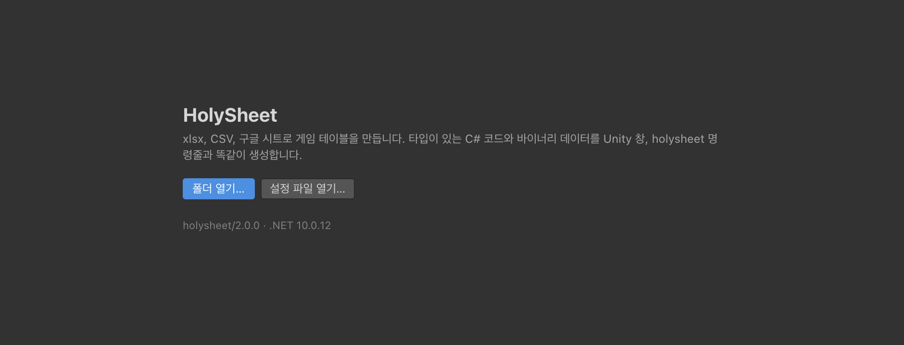

데스크톱 앱은 Unity 창을 Unity 없이 쓸 수 있게 만든 것입니다. macOS와 Windows에서 동작하고, Unity 창이나 명령줄 도구와 같은 `holysheet.json`으로 같은 결과를 만듭니다. Unity를 설치하지 않은 기획자가 자기 컴퓨터에서 시트를 검사하고 빌드할 때 씁니다.

## 설치하기

아직 서명된 설치 파일을 배포하지 않습니다. 저장소에서 직접 빌드합니다. Node.js 20 이상, Rust, .NET 10 SDK가 필요합니다.

```bash
cd desktop
npm install
npm run tauri build
```

설치 파일은 `desktop/src-tauri/target/release/bundle` 아래에 생깁니다. 앱에 엔진이 들어 있으므로, 설치한 컴퓨터에는 .NET이 없어도 됩니다.

## 프로젝트 열기

앱을 처음 실행하면 시작 화면이 나타납니다.



- **폴더 열기…** `holysheet.json`이 있는 프로젝트 폴더를 고릅니다. Unity 프로젝트라면 `Assets`가 있는 폴더입니다.
- **설정 파일 열기…** `holysheet.memorypack.json`처럼 이름이 다른 설정 파일을 직접 고릅니다.

고른 폴더에 `holysheet.json`이 없으면 새로 만들 수 있습니다. 이때 바로 빌드해 볼 수 있는 샘플 시트를 함께 만들지, 출력 폴더를 Unity 프로젝트에 맞출지 고릅니다.

한 번 연 프로젝트는 다음에 앱을 켤 때 자동으로 열립니다. 다른 프로젝트로 바꾸려면 왼쪽 위 프로젝트 이름 옆의 **⋯**를 누릅니다.

프로젝트를 연 뒤의 사용법은 [HolySheet 창 둘러보기](../window/)와 같습니다.

## Unity 창과 다른 점

| 항목 | 데스크톱 앱 |
| --- | --- |
| 프로젝트 | 맨 왼쪽에 프로젝트 이름과 메뉴가 있습니다. 이름이 다른 설정 파일도 열 수 있습니다. |
| 설정의 마지막 묶음 | **앱**에서 언어와 테마를 설정합니다. |
| 테마 | 기본은 어두운 테마입니다. **설정 → 앱 → 테마**에서 밝은 테마나 시스템 설정으로 바꿉니다. |
| 직렬화 라이브러리 경고 | 없습니다. Unity 프로젝트의 패키지를 확인할 수 없기 때문입니다. |
| 커스텀 프로바이더 | 쓸 수 없습니다. Unity 프로젝트 안의 C# 코드이기 때문입니다. Google 접근 방식은 **명령 실행**을 쓰거나 CLI에서 `--offline`으로 스냅샷을 빌드합니다. |
| 단축키 | 전체 빌드는 Ctrl+B(⌘B), 검사는 Ctrl+Shift+B(⇧⌘B)입니다. |

## Unity 프로젝트와 함께 쓰기

기획자는 데스크톱 앱에서, 프로그래머는 Unity 창에서 같은 프로젝트 폴더를 열어 작업할 수 있습니다. 어느 쪽에서 빌드하든 결과가 같으므로, 저장소에 올라가는 파일이 도구에 따라 달라지지 않습니다.
