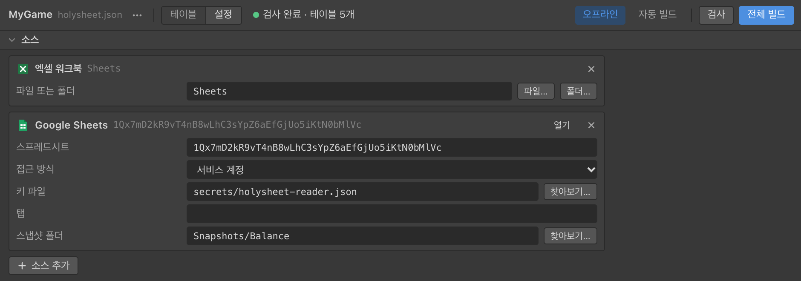
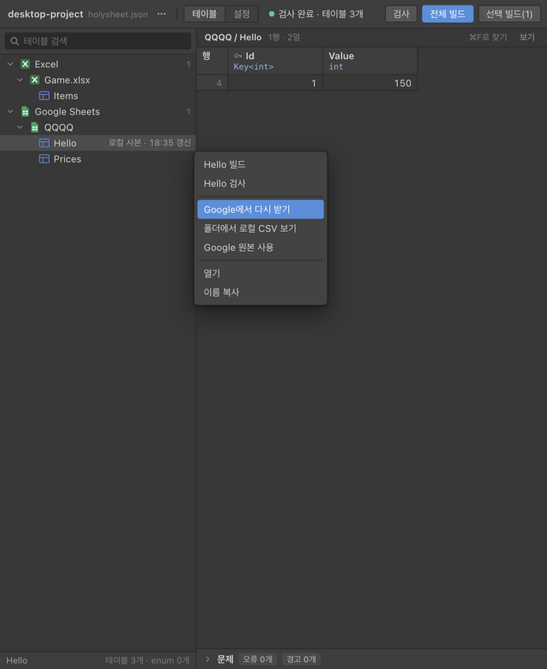

Google Sheets에서 작성한 시트를 그대로 읽어 빌드합니다. 스프레드시트 하나를 연결하거나, Drive 폴더를 통째로 연결할 수 있습니다. Unity 창, 데스크톱 앱, 명령줄 도구에서 설정 방법이 같습니다.

## 스프레드시트 연결하기

1. **설정 → 소스 → 소스 추가**에서 **Google Sheets**를 고릅니다.
2. **스프레드시트** 칸에 문서의 URL을 통째로 붙여넣습니다. 문서 id만 남습니다.
3. **접근 방식**을 고릅니다. 아래 [접근 방식 고르기](#접근-방식-고르기)를 참고하세요.
4. **검사**를 눌러 연결을 확인합니다.

| 칸 | 내용 |
| --- | --- |
| **스프레드시트** | 문서의 URL 또는 id |
| **접근 방식** | HolySheet가 문서를 읽을 때 쓰는 권한 |
| **탭** | 비워 두면 모든 탭을 읽습니다. 일부만 읽으려면 `Item:0, Monster:123456`처럼 `이름:gid`를 적습니다. gid는 탭을 열었을 때 URL 끝의 `gid=` 뒤 숫자입니다. |
| **스냅샷 폴더** | 읽어 온 시트를 CSV로 저장할 폴더. [오프라인으로 빌드하기](#오프라인으로-빌드하기) |

## 접근 방식 고르기

문서를 누구와 공유했는지에 따라 고릅니다.

| 문서의 공유 상태 | 접근 방식 | 준비할 것 |
| --- | --- | --- |
| 링크가 있는 모든 사용자가 볼 수 있음 | **공개 링크** | 없습니다. |
| 링크가 있는 모든 사용자가 볼 수 있음 | **API 키** | Sheets API와 Drive API를 켠 Google API 키 |
| 팀원에게만 공유한 비공개 문서 | **서비스 계정** | 서비스 계정과 그 JSON 키 파일 |

팀에서 쓰는 실제 데이터는 **서비스 계정**을 권합니다. 문서를 공개하지 않아도 되기 때문입니다.

### 서비스 계정으로 연결하기

1. [Google Cloud Console](https://console.cloud.google.com/)에서 프로젝트를 만들고 **Google Sheets API**와 **Google Drive API**를 사용 설정합니다.
2. **서비스 계정**을 만들고 JSON 키를 내려받습니다.
3. 스프레드시트의 **공유**에서 서비스 계정의 이메일 주소(키 파일의 `client_email`)를 **뷰어**로 추가합니다.
4. HolySheet에서 **접근 방식 → 서비스 계정**을 고르고 **키 파일**에 JSON 파일의 경로를 지정합니다.

:::danger
키 파일은 저장소에 올리지 마세요. 프로젝트 폴더 밖에 두거나 `.gitignore`에 추가합니다. 키가 유출되면 그 서비스 계정에 공유된 모든 문서를 읽을 수 있습니다.
:::

### 그 밖의 접근 방식

| 접근 방식 | 이런 때 씁니다 |
| --- | --- |
| **액세스 토큰** | CI가 이미 OAuth 토큰을 가지고 있을 때. 토큰이 든 환경 변수의 이름을 적습니다. |
| **명령 실행** | 자격 증명을 명령으로 얻을 때. 예: `gcloud auth print-access-token`. 명령이 출력한 토큰이나 서비스 계정 키를 사용합니다. |
| **커스텀 프로바이더** | 사내 비밀 저장소처럼 직접 작성한 C# 코드로 자격 증명을 가져올 때. Unity 에디터에서만 동작합니다. |

API 키와 토큰은 파일이나 환경 변수로만 전달합니다. 명령줄 인자로는 받지 않습니다.

## Drive 폴더 연결하기

폴더를 연결하면 그 안의 Google 스프레드시트와 `.xlsx` 파일을 모두 읽습니다. 폴더에 문서를 추가하면 다음 빌드부터 자동으로 포함되므로, 문서가 자주 늘어나는 팀에 편합니다.

1. **소스 추가**에서 **구글 드라이브 폴더**를 고릅니다.
2. 폴더의 URL(`drive.google.com/drive/folders/…`)을 붙여넣습니다.
3. 접근 방식을 고릅니다. 폴더는 **공개 링크**로 읽을 수 없으므로 API 키나 서비스 계정 같은 다른 방식을 고릅니다. 서비스 계정을 쓴다면 폴더를 서비스 계정 이메일에 공유합니다.

- 폴더 바로 아래의 파일만 읽습니다. 하위 폴더는 따로 소스로 추가합니다.
- 이름이 `#`이나 `~`로 시작하는 파일은 건너뜁니다.

## 특정 탭을 로컬 사본으로 사용하기

1. **테이블** 목록에서 원하는 Google 탭을 우클릭하고 **로컬 사본 사용**을 누릅니다. 여러 탭을 합친 테이블은 펼쳐서 탭 하나를 고릅니다.
2. 탭 옆에 **로컬 사본 · 14:32 갱신**처럼 마지막으로 받은 시각이 표시됩니다. 검사와 빌드는 이 CSV를 읽습니다.
3. 그 탭의 최신 값이 필요하면 우클릭하고 **Google에서 다시 받기**를 누릅니다. 표와 문제 목록도 함께 갱신됩니다.
4. **Google 원본 사용**을 누르면 로컬 사본을 해제합니다. 다음 검사나 빌드부터 Google 소스를 읽습니다.

**폴더에서 로컬 CSV 보기**를 누르면 저장한 파일을 찾을 수 있습니다. 사본은 프로젝트의 `.holysheet/local-copies/`에 저장되며 Unity 창과 데스크톱 앱에서 함께 사용합니다. Ctrl+R, ⌘R 또는 F5를 누르면 새 탭을 찾고 로컬 사본을 포함한 모든 소스를 갱신합니다. Excel은 디스크에 저장한 파일을 읽습니다.

## 오프라인으로 빌드하기

**스냅샷 폴더**를 지정하면 Google에서 읽은 시트를 CSV로 저장할 수 있습니다. 팀에서 스냅샷을 저장소에 올리면 변경 내역을 비교하거나 CI에서 `holysheet build --offline`으로 빌드할 수 있습니다. 스냅샷 폴더가 있는 Google 소스는 이 옵션으로 저장된 CSV를 읽습니다.

## 요청 횟수

Google Sheets API는 계정마다 1분에 읽기 요청 60회까지만 허용합니다. HolySheet는 이 한도에 걸리지 않도록 요청을 줄입니다.

- API 키나 서비스 계정 같은 자격 증명을 쓰면 탭을 하나씩 받지 않고 한꺼번에(요청 한 번에 50개까지) 읽습니다.
- 일반 검사와 빌드에서는 Drive의 버전 번호가 같으면 저장해 둔 사본을 씁니다. 온라인 새로고침은 버전 번호가 아직 그대로여도 Google에서 값을 다시 받습니다.
- ‘요청이 너무 많음’이나 서버 오류 응답을 받으면 잠시 기다렸다가 다시 시도합니다. 다섯 번째에도 실패하면 오류로 알립니다.
