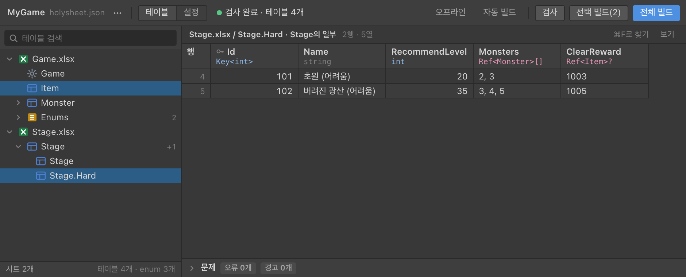

선택 빌드는 고른 시트만 다시 읽고, 나머지 시트는 **이 컴퓨터에서 마지막으로 빌드했을 때의 내용**을 그대로 씁니다.

## 이런 때 씁니다

- **팀원이 작업 중일 때.** 같은 스프레드시트에서 팀원이 `Monster`를 반쯤 고친 상태라도, 내가 고친 `Item`만 먼저 반영할 수 있습니다.
- **시트가 많을 때.** Google 시트 탭 수십 개 중 하나만 고쳤다면 그 탭만 내려받습니다.

## 창에서 빌드하기

1. 목록에서 빌드할 항목을 고릅니다. Ctrl(macOS는 ⌘)을 누른 채 누르면 여러 개를, Shift를 누른 채 누르면 범위를 고릅니다.
2. 위쪽의 **선택 빌드(n)**을 누릅니다. 괄호 안의 숫자는 다시 빌드되는 테이블의 수입니다.



| 고른 항목 | 다시 읽는 범위 |
| --- | --- |
| 워크북 | 그 워크북의 모든 시트 |
| 테이블 | 그 테이블을 이루는 모든 시트 ([나눠 적은 시트](../../sheets/splitting/) 포함) |
| 시트 | 그 시트 한 장 |

버튼에 마우스를 올리면 다시 빌드되는 테이블의 이름이 보입니다. 항목을 우클릭해 **○○ 빌드**나 **○○ 검사**를 골라도 됩니다.

## 결과는 전체 빌드와 같습니다

선택 빌드도 모든 테이블을 빠짐없이 만듭니다. 선택하지 않은 시트를 다시 읽지 않을 뿐입니다. 그래서 테이블 사이의 참조 검사도 평소와 똑같이 이루어지고, 내용이 바뀌지 않은 테이블의 파일은 다시 쓰지 않습니다.

## 선택 빌드가 거부될 때

선택하지 않은 시트의 내용은 `.holysheet/cache` 폴더에 저장된 마지막 빌드에서 가져옵니다. 이 캐시가 지금의 데이터 폴더보다 오래됐을 수 있으면 선택 빌드를 거부합니다. 옛 값이 되살아나는 것을 막기 위해서입니다.

| 상황 | 메시지 |
| --- | --- |
| 이 컴퓨터에서 빌드한 적이 없음 | `There is no sheet cache from an earlier build on this machine.` |
| 저장소에서 다른 사람의 빌드 결과를 받음 | `The data folder was not written by the last build on this machine, for example after a pull.` |

두 경우 모두 **전체 빌드**를 한 번 하면 다시 선택 빌드를 쓸 수 있습니다.

## 명령줄에서

`--only`에 목록에 보이는 이름을 적습니다. 워크북만 적으면 그 워크북 전체, `워크북/시트`로 적으면 시트 한 장입니다.

```bash
holysheet build --only Item.xlsx
holysheet build --only "Monster.xlsx/Monster.Boss"
holysheet build --only Item.xlsx,Stage.xlsx
```

워크북 이름은 종류에 따라 다릅니다. Excel은 파일 이름(`Item.xlsx`), CSV는 폴더 이름(`Csv`), Google은 목록에 보이는 이름(스프레드시트의 제목 또는 id)입니다.
