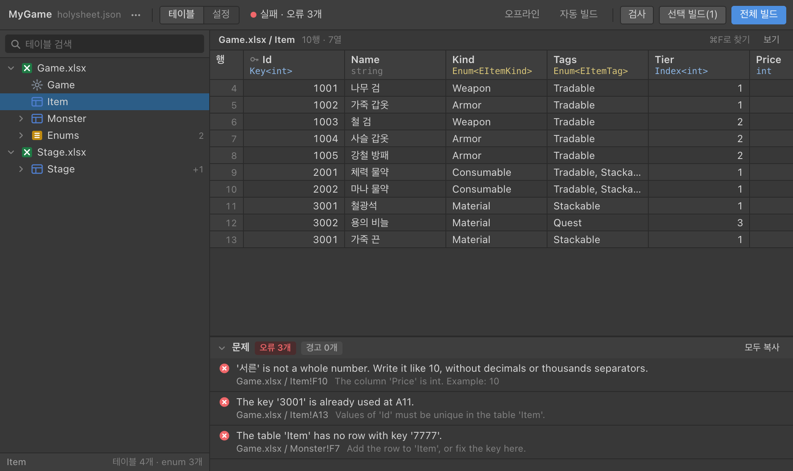

HolySheet는 빌드하기 전에 시트를 검사합니다. 잘못된 값이 게임에 들어가기 전에, 어느 셀이 왜 틀렸고 어떻게 고치는지 알려 줍니다.

## 검사와 빌드의 차이

| | 검사 | 빌드 |
| --- | --- | --- |
| 시트를 읽고 문제를 찾나요 | 예 | 예 |
| 코드와 데이터를 쓰나요 | 아니요 | 오류가 없을 때만 |

- 시트를 고치는 동안에는 **검사**로 확인하고, 다 고친 뒤 **빌드**합니다.
- **오류가 하나라도 있으면 빌드는 코드와 데이터를 하나도 쓰지 않습니다.** 일부만 바뀐 어중간한 결과가 생기지 않으므로, 이전에 빌드한 데이터는 그대로 남습니다.
- **경고**는 빌드를 막지 않습니다. 값은 읽었지만 의도와 다를 수 있는 곳을 알려 줍니다.

## 문제 읽기

검사에 실패하면 상태가 **실패 · 오류 3개**로 바뀌고 아래쪽에 문제 목록이 펼쳐집니다.



문제 하나는 세 부분으로 이루어집니다.

```text wrap
'서른' is not a whole number. Write it like 10, without decimals or thousands separators.
Game.xlsx / Item!F10    The column 'Price' is int. Example: 10
```

| 부분 | 예 | 의미 |
| --- | --- | --- |
| 메시지 | `'서른' is not a whole number.` | 무엇이 잘못됐는지 |
| 위치 | `Game.xlsx / Item!F10` | `Game.xlsx` 워크북, `Item` 시트의 F열 10행 |
| 고치는 방법 | `The column 'Price' is int. Example: 10` | 어떻게 적어야 하는지 |

문제 메시지는 어느 도구에서나 영어로 표시됩니다.

- 문제를 **더블클릭**하면 그 파일이 열립니다.
- **우클릭**하면 메시지나 위치를 복사할 수 있습니다. **모두 복사**는 목록 전체를 복사합니다. 담당자에게 그대로 전달할 때 편합니다.

## 자주 만나는 오류

| 상황 | 메시지 | 고치는 방법 |
| --- | --- | --- |
| 숫자 열에 글자 | `'서른' is not a whole number.` | `30`처럼 숫자만 적습니다. 소수점과 천 단위 쉼표도 쓸 수 없습니다. |
| 키가 겹침 | `The key '3001' is already used at A11.` | 둘 중 하나의 키를 바꿉니다. |
| 키가 비어 있음 | `The key 'Id' is empty.` | 키를 적습니다. 행을 빼려면 A열을 `#`이나 `~`로 시작합니다. |
| 없는 행을 참조 | `The table 'Item' has no row with key '7777'.` | `Item`에 그 행을 추가하거나 번호를 고칩니다. |
| 필수 참조가 비어 있음 | `The cell is empty, but a Ref<Item> must point at a row.` | 값을 적거나 타입을 `Ref<Item>?`로 바꿉니다. |
| enum에 없는 이름 | `'Wepon' is not a member of EItemKind.` | 대개 오타입니다. 메시지에 나온 멤버 목록에서 골라 적습니다. |
| 타입 표기가 틀림 | `The type '…' is not understood.` | [타입](../../sheets/types/)을 확인합니다. |
| 같은 이름의 시트가 둘 | `The table 'Item' is already defined by '…'.` | 하나의 이름을 바꾸거나 `Item.Weapons`처럼 [나눠 적습니다](../../sheets/splitting/). |
| 탭 이름이 규칙과 다름 | `The sheet name is not understood.` | 이름을 고치거나, 읽지 않을 시트면 `#`으로 시작합니다. |
| 읽을 테이블이 없음 | `No table was found.` | 소스 경로와 헤더 세 줄을 확인합니다. |

## 경고

| 상황 | 메시지 | 고치는 방법 |
| --- | --- | --- |
| 배열에 천 단위 쉼표 | `'1,000' looks like one number with thousands separators` | 쉼표가 구분자로 읽혔습니다. 셀 서식을 일반 텍스트로 바꿉니다. |
| 배열을 `\|`로 구분 | `'sword\|blade' contains '\|', but arrays are separated by ','` | 값 하나로 읽혔습니다. 쉼표로 구분합니다. |
| 헤더 없는 열에 값 | `This column has values but no type and no field name` | 읽지 않는 열입니다. 메모용이면 헤더를 `#`으로 시작해 의도를 밝힙니다. |

## 빌드가 파일을 쓰지 않고 멈출 때

출력 폴더에 HolySheet가 만들지 않은 파일이 같은 이름으로 있으면, 빌드는 그 파일을 덮어쓰지 않고 멈춥니다.

```text wrap
HolySheet cannot identify it as its own output. Move the file or choose another output path.
```

직접 만든 파일을 실수로 잃지 않게 하기 위한 동작입니다. 메시지에 나온 파일을 다른 곳으로 옮기거나, **설정 → 출력**에서 다른 폴더를 지정하세요.
