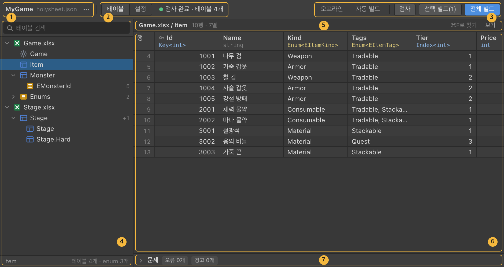
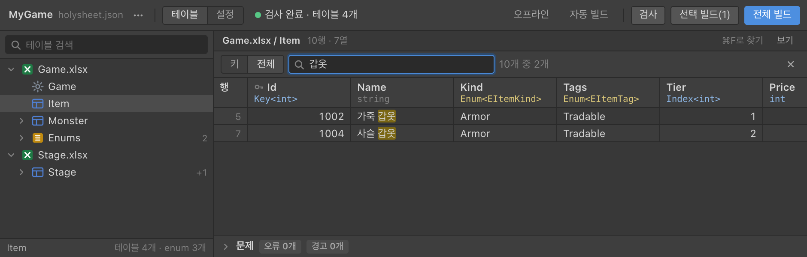
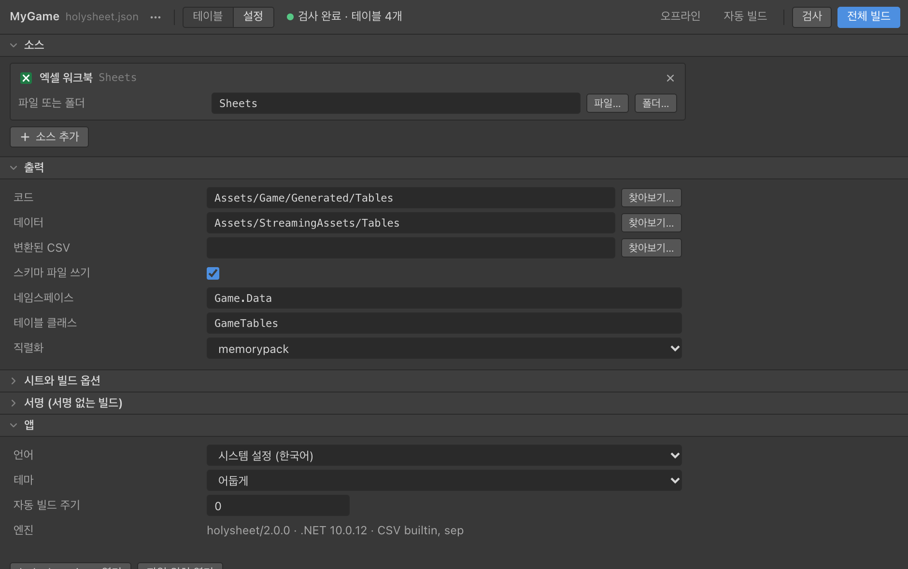

HolySheet 창은 시트를 읽은 결과를 보여 주고, 검사와 빌드를 실행하는 곳입니다. Unity에서는 **Tools → HolySheet → Tables**로 엽니다.

Unity 창과 [데스크톱 앱](../desktop/)은 구성과 동작이 같습니다. 이 문서의 화면은 데스크톱 앱에서 찍었으며, 맨 왼쪽의 프로젝트 이름을 빼면 Unity 창에서도 같은 자리에 같은 것이 있습니다.

## 테이블 페이지

| 번호 | 이름 | 하는 일 |
| --- | --- | --- |
| ① | 프로젝트 | 열려 있는 프로젝트입니다. 데스크톱 앱에만 있습니다. |
| ② | 페이지와 상태 | **테이블**과 **설정** 페이지를 오갑니다. 오른쪽 점과 글자는 마지막 실행의 결과입니다. |
| ③ | 실행 버튼 | 검사와 빌드를 실행합니다. 아래 [실행 버튼](#실행-버튼)에서 설명합니다. |
| ④ | 목록 | 워크북, 테이블, enum을 보여 줍니다. 항목을 누르면 오른쪽에 내용이 나타납니다. |
| ⑤ | 제목 줄 | 지금 보는 시트의 위치, 행과 열의 수, **보기** 메뉴가 있습니다. |
| ⑥ | 데이터 | 빌드가 읽은 그대로의 데이터입니다. 제외한 행과 열은 보이지 않습니다. |
| ⑦ | 문제 | 마지막 실행에서 나온 오류와 경고입니다. 누르면 목록이 펼쳐집니다. |

### 실행 버튼

| 버튼 | 하는 일 |
| --- | --- |
| **검사** | 시트를 읽고 문제를 찾습니다. 코드와 데이터는 쓰지 않으므로 언제든 눌러도 됩니다. |
| **전체 빌드** | 모든 시트를 읽고 C# 코드와 데이터 파일을 씁니다. |
| **선택 빌드(n)** | 목록에서 선택한 시트만 다시 읽어 빌드합니다. [선택한 시트만 빌드하기](../partial-build/) |

상태 표시는 마지막 실행의 결과를 알려 줍니다.

| 상태 | 의미 |
| --- | --- |
| **검사 완료 · 테이블 4개** | 검사에서 오류가 없었습니다. 경고는 있을 수 있습니다. |
| **빌드 완료 · 테이블 4개** | 빌드해서 파일을 썼습니다. |
| **최신 상태** | 빌드했지만 바뀐 내용이 없어 파일을 쓰지 않았습니다. |
| **실패 · 오류 3개** | 오류가 있어 아무것도 쓰지 않았습니다. [검사와 문제 해결](../problems/) |
| **실행 중** | 시트를 읽고 있습니다. |

### 목록

목록은 워크북 아래에 그 워크북이 만드는 테이블과 enum을 보여 줍니다. 소스를 둘 이상 연결하면 소스별로 먼저 묶이고, 묶음에는 Excel, Google Sheets, CSV 같은 종류가 표시됩니다.

- 테이블 옆의 `+1`은 그 테이블에 [나눠 적은 시트](../../sheets/splitting/)가 한 장 더 있다는 뜻입니다. 펼치면 시트별로 볼 수 있습니다.
- 톱니바퀴 아이콘은 [설정 테이블](../../sheets/splitting/#설정-테이블)입니다.
- 위쪽 검색 칸에 이름을 입력하고 Enter를 누르면 다음 항목으로, Shift+Enter를 누르면 이전 항목으로 이동합니다.
- 항목을 더블클릭하면 원본 파일이 열립니다. Google 시트는 브라우저에서 열립니다.
- 우클릭하면 그 항목만 빌드하거나 검사할 수 있습니다.

### 데이터 살펴보기

열 제목 아래에는 타입이 색으로 표시됩니다. 맨 왼쪽 **행** 열의 숫자는 원본 시트의 행 번호라서, 문제가 있는 값을 Excel에서 바로 찾을 수 있습니다.

| 하고 싶은 일 | 방법 |
| --- | --- |
| 정렬하기 | 열 제목을 누릅니다. 다시 누르면 반대 순서가 됩니다. |
| 행 찾기 | Ctrl+F(macOS는 ⌘F)를 누르고 글자를 입력합니다. 그 글자가 들어 있는 행만 남습니다. |
| 표 모양 바꾸기 | **보기** 메뉴에서 격자선, 글자 정렬, 줄무늬 배경을 고릅니다. |

찾기 막대의 **키**는 키 열에서만, **전체**는 모든 열에서 찾습니다. Esc를 누르면 닫힙니다.

## 설정 페이지

**설정**을 누르면 `holysheet.json`의 내용을 고칠 수 있습니다. 바꾼 값은 바로 파일에 저장됩니다. 각 칸에 마우스를 올리면 설명이 나타납니다.

| 묶음 | 내용 |
| --- | --- |
| **소스** | 시트를 어디에서 읽을지 정합니다. [소스 연결하기](../sources/) |
| **출력** | 코드와 데이터를 쓸 폴더, 네임스페이스, 직렬화 라이브러리를 정합니다. |
| **시트와 빌드 옵션** | 헤더 행의 순서, 배열 구분자 등을 정합니다. |
| **서명 (…)** | 데이터에 서명해 바꿔치기를 막습니다. 제목의 괄호는 지금 서명하고 있는지를 보여 줍니다. [변조 감지와 서명](../../runtime/integrity/) |
| **에디터** / **앱** | 창의 언어처럼 나에게만 적용되는 설정입니다. Unity 창에서는 **에디터**, 데스크톱 앱에서는 **앱**입니다. |

모든 항목의 의미는 [holysheet.json 레퍼런스](../../reference/config/)에 정리되어 있습니다.

## 단축키

| 동작 | Unity 창 | 데스크톱 앱 |
| --- | --- | --- |
| 새로고침 | Ctrl+R, ⌘R 또는 F5 | Ctrl+R, ⌘R 또는 F5 |
| 전체 빌드 | Ctrl+Shift+Alt+B (macOS는 ⌘⇧⌥B) | Ctrl+B (macOS는 ⌘B) |
| 검사 | **Tools → HolySheet → Check Tables** | Ctrl+Shift+B (macOS는 ⇧⌘B) |
| 데이터에서 찾기 | Ctrl+F (macOS는 ⌘F) | Ctrl+F (macOS는 ⌘F) |

Ctrl+R, ⌘R 또는 F5는 Drive의 버전 번호가 같아도 Google 원본을 읽고 로컬 사본, 미리보기와 문제 목록을 갱신합니다. 탭 하나만 갱신하려면 트리에서 해당 탭을 우클릭하고 **Google에서 다시 받기**를 누르세요. [특정 탭을 로컬 사본으로 사용하기](../google-sheets/#특정-탭을-로컬-사본으로-사용하기)

Unity에서는 HolySheet 창을 열지 않아도 **Tools → HolySheet → Build Tables**로 빌드할 수 있습니다.
